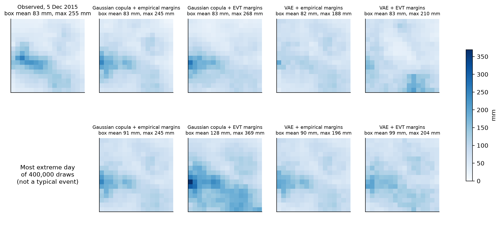
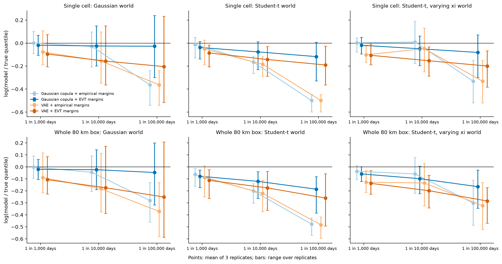
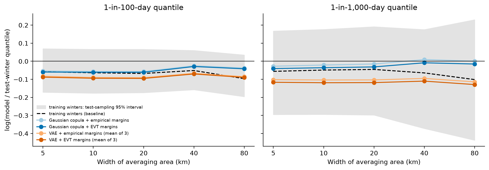
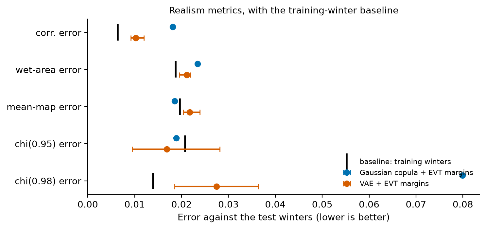

# Can a rainfall generator extrapolate? A leakage-free pilot on Cumbrian winter extremes

A small pilot study of the central question in the Edinburgh E5 DTP project *Stochastic generation
of realistic UK rainfall extremes via generative AI*: **when does a generator that produces
realistic rainfall fields also assign the right probabilities to events more severe than any it
was trained on?**

It uses 64 winters (1961–2025) of HadUK-Grid daily rainfall on a 16 × 16 grid of 5 km cells over
the Lake District, and holds out Storm Desmond (5 December 2015), the wettest day in the record,
as a stress test.



**Main findings**

* **Twelve held-out winters cannot rank tail models, and the pilot shows why.** The test winters
  happen to be wetter than the training winters. A generator that reproduced its training data
  *perfectly* would look about 5–9% "too low" against them. Judged naively, the Gaussian copula wins at
  every scale. Against the training data it was fitted to, the picture splits by scale:
  * **single cells:** the Gaussian copula is accurate and the VAE is 2–8% low;
  * **80 km area averages:** the Gaussian copula is 6–9% too high and the VAE is within about 5%.
* **The VAE's realism advantage is specific, and so is its weakness.** It reproduces spatial
  correlation and high-level joint extremes (chi) much better than the Gaussian copula. Both
  generators are equally good on wet-area fraction and mean rainfall. The copula overstates joint
  extremes, which matches its overstated area totals. The VAE produces extreme normal scores at
  only 0.59–0.74 times the correct rate at one day in 1,000, against a Monte Carlo noise range
  of 0.92–1.17, so its GPD tails are reached too rarely. The size of this shortfall depends on the
  training run: across six trained VAEs (including three from an earlier run) it ranges from 0.47
  to 0.89.
* **Storm Desmond's probability is very uncertain.** With extreme-value (EVT) margins, a day
  with a cell at least as wet as Desmond's 255 mm recurs about every 64 winters (Gaussian copula)
  or 201 winters (VAE).
  * Refitting the margins alone gives intervals spanning a factor of 5 to 22 (25–282 and
    57–1,244 winters), most of it due to the GPD shape ξ.
  * For the VAE, training randomness adds about as much again: across six trained VAEs the
    return period of a Desmond-sized box mean ranges from 42 to 457 winters.
  * Without EVT margins, Desmond's wettest cell is impossible by construction.
  * A single observed event cannot separate 64 from 200 winters.
* **A shared tail shape is a real limitation.** In a simulation where the true ξ varies across the
  region, one shared ξ leaves single-cell errors of about 16–20% at one day in 100,000 (mean
  absolute log ratio 0.17–0.18), even when the fitted ξ (0.0825) is close to the true average
  (0.0775). These errors cancel in the regional average.

---

## Design

**A 2 × 2 comparison.** Each generator maps rainfall to normal scores with per-cell margins,
models the spatial dependence of those scores, and maps samples back to millimetres. Two choices
are crossed, so their effects can be separated:

| | **empirical margins** (cannot exceed the training maximum) | **EVT margins** (generalised Pareto tail above each cell's 95th percentile, one shape ξ shared by all cells) |
|---|---|---|
| **Gaussian copula** | simplest model | classical spatial statistics |
| **VAE** (convolutional; latent Gaussian mixture) | "learn the data distribution" | hybrid: neural dependence + EVT tails |

The dependence models are fitted once, on normal scores from the EVT margins, and shared by both
margin types. Every comparison of margins also uses the same random draws (common random
numbers), so differences between columns are due to the margins alone.

**Leakage-free evaluation.**
* Whole winters are assigned by start year, a rule fixed before any model was fitted: years
  ending in **0 or 5 → test** (12 winters, including Storm Desmond's 2015/16), **3 or 8 →
  validation** (13), the rest → **training** (39). Interleaving keeps a long-term trend from being
  confused with model error.
* Margins, normal scores, the copula and the VAE use **training** winters only. **Validation**
  winters are used only for VAE early stopping and choosing the size of the latent mixture.
  **Test** winters are used only in evaluation. `Split.check()` fails if any day or winter is
  shared between sets.
* **Baselines.** Every test-winter comparison is repeated for the training winters themselves (and
  the validation winters). This is the score of a model that reproduced its training data
  perfectly, and it separates model error from differences between samples of winters. It is a
  reference point, not a lower bound: a model can beat it by chance.
* **Uncertainty** comes from block bootstraps over **whole winters**, because days within a winter
  are dependent:
  * over test winters for the reference statistics;
  * over training winters for the fitted tails, refitting the EVT margins with the dependence
    models held fixed.

  The bootstrap re-evaluates the same 2–6 million generated days exactly for every replicate, using
  a conservative screen, so its intervals are not dominated by Monte Carlo noise.

**Diagnostics, mapped to the E5 research questions.**

| Diagnostic | Research question |
|---|---|
| tail quantiles of single cells and of area averages (5–80 km), against test *and* training winters | RQ1–2: local intensity and rainfall accumulated over areas |
| chi(u) against distance | RQ2: extremal dependence and spatial extent |
| wet-area fraction, bulk correlation, mean rainfall map, each against its baseline | RQ2–3: dry areas and ordinary rainfall; visual realism |
| realism and tail accuracy, reported separately | RQ3: "distinguish improvements in visual realism from improvements in estimated tail probabilities" |
| a controlled simulation study with known tails, including a world where the EVT margins are misspecified | RQ3: "controlled simulation studies, in which tail properties are known" |
| probability of a Desmond-sized day, with Monte Carlo and tail-uncertainty intervals | RQ3: withheld severe events as stress tests |

---

## Results

### Controlled simulation study (notebook 02)



*log(model / true quantile); 0 is unbiased. Points are means over 3 replicates; bars are the range
over replicates, not confidence intervals.*

There are three true worlds, each built from the real training winters:
* **Gaussian:** extremes at different cells become independent at high levels.
* **Student-t:** joint extremes stay dependent.
* **Student-t with a tail shape ξ that varies from west to east.**

**The first two worlds are best cases.** Their true margins have exactly the form of the fitted
EVT margins, and the Gaussian world *is* the Gaussian copula + EVT generator.

* **Empirical margins fail predictably beyond the training data:** at one day in 100,000, they are
  28–40% too low for single cells in every world (24–38% for the 80 km box).
* **Correctly specified EVT margins remove most of that bias on average** (−0.03 Gaussian world,
  −0.12 Student-t, with the Gaussian copula). But the spread between replicates is wide (−0.30 to
  +0.24 in the Gaussian world) and is ordered by the fitted ξ in all six replicates. The fitted ξ
  ranged from −0.0075 to 0.138 against a true value of 0.0775.
* **Misspecified ξ (varying world):**
  * The average bias stays modest (−0.08).
  * In the two replicates whose fitted ξ (0.0825) was close to the true mean, single cells are
    still off by a mean absolute log ratio of 0.17–0.18. In the Student-t world, replicates with a
    well-estimated ξ gave 0.03–0.04.
  * Averaged over its 3 replicates, which include one with a badly estimated ξ, EVT margins still
    beat empirical ones (0.22 against 0.33).
* **Joint extremes matter for area totals.** In both Student-t worlds the Gaussian copula
  underestimates chi(0.999) (0.18–0.24 against 0.44 at 100 km). Its bias for the 80 km box is
  larger than for single cells (−0.19 against −0.12 at one day in 100,000).
* **The VAE is inconsistent between training runs.**
  * Its chi(0.999) at 100 km ranges from 0.16 to 0.42 (truth 0.44) in the Student-t world, and from
    0.12 to 0.30 in the Gaussian world, where the truth is 0.20 and the copula gets 0.19–0.24.
  * Its tail quantiles are too low on average even at one day in 1,000 (mean log ratio −0.09 to
    −0.14 across worlds and scales), though not in every replicate.
  * EVT margins only partly fix this.

### Real data: Cumbria (notebook 03)



*The dashed line is the training winters themselves (the baseline) and the grey band is its
test-sampling 95% interval. The gap between the dashed line and zero is a property of the test
winters, not of any model.*

Gaussian copula = 1 run (no training randomness); VAE = range over 3 seeds; both with EVT margins.

| | Gaussian copula | VAE (3 seeds) | Baseline / reference |
|---|---|---|---|
| 1-in-100-day quantile, single cells, vs **training** winters | **−0.002** | −0.02 to −0.05 | 0 |
| 1-in-100-day quantile, 80 km box, vs **training** winters | +0.055 | **−0.004 to +0.013** | 0 |
| 1-in-1,000-day quantile, single cells, vs training | **+0.015** | −0.03 to −0.08 | 0 |
| 1-in-1,000-day quantile, 80 km box, vs training | +0.086 | **−0.05 to +0.01** | 0 |
| Same quantiles vs **test** winters (cells / box, 1 in 100) | −0.06 / −0.04 | −0.08 to −0.11 / −0.08 to −0.10 | training winters: −0.06 / −0.10 |
| Test days above the model's per-cell 1-in-100 level | 1.26% | 1.35–1.46% | training winters: 1.26% (95%: 0.78–1.81%) |
| Correlation error (log scale, lower is better) | 0.018 | **0.009–0.012** | 0.006 |
| chi(0.98) error, joint extremes | 0.080 | **0.019–0.036** | 0.014 |
| Wet-area error / mean-map error | 0.023 / 0.019 | 0.020–0.022 / 0.020–0.024 | 0.019 / 0.020 |
| Normal scores above the 1-in-1,000 level (target 1×) | 1.07× | 0.59–0.74× | noise range 0.92–1.17× |
| Desmond-sized wettest cell (≥ 255 mm), EVT margins: return period | 64 winters (25–282) | 201 winters (57–1,244) | observed once in 64 winters |
| Desmond-sized box mean (≥ 83.5 mm), EVT margins | 65 winters (34–175) | 222 winters (115–806) | |
| Same, empirical margins: wettest cell / box mean | impossible\* / 83 winters | impossible\* / 383 winters | |

Log ratios: 0 is unbiased and −0.05 means about 5% too low. The bracketed return-period intervals
cover tail (margin) uncertainty from 100 bootstrap resamples of the training winters. Monte Carlo
error is much smaller (for example 55–75 and 172–235 winters for the wettest cell). VAE return
periods pool 3 seeds; single seeds give 129–477 (cell) and 114–457 (box) winters.
\* Guaranteed by construction: the training maximum is 245.2 mm.

* **Every generator lies inside the test-sampling interval of the baseline** at both levels and all
  scales. The test winters cannot rank the generators. The comparison against training winters
  shows each model's error relative to the data it learned from.
* **The Gaussian copula overstates joint extremes:** its chi(0.98) lies above the test winters'
  pointwise 95% interval in all 10 distance bands. The training winters' chi is close to the test
  winters', so this is a model property and not test-sample noise. The VAE's chi is below the test
  interval in the 5 km band for every seed, consistent with (but not shown to be caused by) its
  independent per-pixel decoder noise.
* **The probability of a Desmond-sized day**, within the margin bootstrap, depends mainly on the
  shared GPD shape ξ (bootstrap 95% interval 0.018 to 0.122). For the VAE it also depends strongly
  on training randomness. Box-mean return periods are 114–457 winters across these three seeds,
  and 42–457 across six trained VAEs including the earlier run. The pooled VAE estimate was 91
  winters in that run against 222 here.
* **The Desmond figure (top) is illustrative only:** one sample per generator. Both
  Gaussian-copula analogues put the heaviest rain over the western fells, as observed. The VAE
  analogues are flatter, and the VAE + EVT analogue peaks in the south-east. Its correlation with
  the observed field (0.40) is at the bottom of the range for the 20 wettest training days
  (0.37–0.91). All analogues lie within the training days' range of roughness.



---

## Limitations

* **Data scale.** Daily totals on a 5 km grid interpolated from rain gauges, not hourly 2.2 km
  convection-permitting simulations. One region, winters only.
* **No duration or movement.** Days are generated independently, so persistence, storm movement
  and multi-day totals (Desmond's three-day total) are not modelled.
* **Stationarity assumed.** Mean winter rainfall rose over 1961–2025 (Kendall's τ = 0.28,
  p = 0.001, treating winters as independent). The interleaved split spreads that trend across all
  sets rather than removing it, and climate conditioning is not attempted.
* **Return periods ignore clustering.** They treat days as independent; Desmond's wettest days were
  consecutive.
* **Small test set.** Twelve test winters cannot rank tail models (see Results). The training-data
  comparisons measure fit to the training climate, not out-of-sample skill.
* **Incomplete uncertainty.**
  * Tail-uncertainty intervals hold the dependence models fixed: they omit uncertainty in the
    copula's correlations and in VAE training.
  * The variation across VAE seeds is reported separately, from only 3 seeds.
  * The chi intervals are pointwise over 10 correlated distance bands.
  * Percentile bootstraps over 12 winters may under-cover.
* **Simulation study.**
  * Three replicates per world; synthetic days are independent.
  * Two of the three worlds are best cases for the EVT margins, and the Gaussian world is a best
    case for the copula.
  * The 80 km truth at one day in 100,000 rests on about 40 exceedances in 4 million simulated
    days.
* **Modelling choices not varied:** one VAE architecture (with independent per-pixel decoder
  noise); a 95% threshold, with no sensitivity analysis; one ξ shared by all cells.
* **Choices made after seeing results.** The split, the 95% threshold and the fitting code were
  fixed before any test-winter evaluation of a generator. One earlier look at test data should be
  recorded: while the margin code was being written, a development script printed the test-set
  maxima and compared the training-fitted 1-in-100-winter level with Desmond's 255 mm. The
  following were decided later.
  * **Before any test evaluation:**
    * The **latent Gaussian mixture** for VAE sampling (ex-post density estimation) was adopted
      after samples from the standard-normal prior were found to be under-dispersed against the
      training and validation winters.
    * The mixture size is chosen on validation winters.
  * **After test metrics had been seen** (in development runs and in the first full run):
    * The **normal-score exceedance check** was added, as a direct test of an explanation
      suggested by the simulation study.
    * The **Desmond figure** was changed from each generator's most extreme day to Desmond-sized
      days; both are shown.
    * The table's emphasis on **one day in 100** was chosen after seeing that one day in 1,000 is
      too noisy.
  * **After an independent review of the first full run:**
    * training- and validation-winter **baselines** for every metric;
    * **comparisons against the training winters**;
    * the **varying-ξ simulation world** and the mean absolute error;
    * a Monte Carlo **noise reference** for the normal-score check;
    * **exact bootstrap re-evaluation** of Desmond probabilities;
    * **contiguous distance bands** for chi;
    * a fix that makes the **VAE seeds independent**: previously a per-epoch reseed for validation
      reset the training random stream.

    All experiments were then rerun. These changes affect evaluation and reporting only, apart
    from the seed fix, which changes VAE training. No fitting procedure or hyperparameter was
    tuned on test winters.
  * **After a second independent review:**
    * The bootstrap screen was corrected to allow for a small downward step (at most 0.04 mm)
      in the EVT quantile function where the GPD tail takes over. A unit test now checks the
      bound, and the Cumbria experiment was rerun.
    * The wording of several claims was narrowed.
    * Results from the first full run's three VAEs are reported where they show
      seed-to-seed variability.

---

## Next steps

Each extension follows from a result above and maps to a research question.

* **Validate tail probabilities across all winters, not one small test set** (RQ3). The 12 test
  winters cannot rank the generators. Holding out each block of winters in turn, and refitting
  every time, would use all 64 winters for evaluation while keeping the leakage rules.
* **Let the tail shape vary in space** (RQ1–2). In the simulation, one shared ξ leaves single-cell
  errors of about 16–20% at one day in 100,000 when the true ξ varies, even when the fitted ξ is
  close to the true average. A ξ that varies smoothly across cells, for example with a spatial
  penalty or a Bayesian hierarchical prior, would keep the pooling while removing that error.
* **Replace the VAE with a stronger generative model, keeping EVT margins** (RQ2–3). The VAE gets
  joint extremes right but produces extreme normal scores too rarely, and its results vary
  between training runs. A diffusion model, as in recent UK precipitation emulation, could be
  combined with the same EVT margins and judged with the same diagnostics.
* **Account for uncertainty in the dependence model** (RQ3). The tail-uncertainty intervals here
  hold the copula and the VAE fixed. Refitting the dependence model inside the bootstrap, or
  averaging over many training runs, would give honest intervals for events like Storm Desmond.
* **Condition on climate** (RQ4). Mean winter rainfall rose over 1961–2025, and this pilot is
  stationary. Conditioning the generator on large-scale climate drivers, or on a warming level,
  would move from describing the past climate to projecting future extremes.
* **Move to convection-permitting data** (RQ1). Repeat the comparison on hourly 2.2 km simulations,
  where short, intense convective rainfall matters more than in daily winter totals.

---

## Repository

| Path | Contents |
|---|---|
| `notebooks/01_data_overview.ipynb` | the data, the split, Storm Desmond, the trend, spatial dependence |
| `notebooks/02_simulation_study.ipynb` | the four generators against known tails in three true worlds |
| `notebooks/03_cumbria_generators.ipynb` | real data: baselines, tails vs test and training, realism, chi, Storm Desmond |
| `src/rainpilot/` | data split, margins, Gaussian copula, VAE, generators, diagnostics |
| `experiments/` | the experiments that produce `results/` (resumable) |
| `tests/` | unit tests: leakage guards, margin round trips, known-tail recovery, exact quantiles, chi |
| `data/` | the Cumbria subset (Open Government Licence) and the script that downloads it from CEDA |
| `results/`, `figures/` | outputs of the runs reported above |

**Reproduce.**
```bash
pip install -r requirements.txt
pytest -q tests                                              # about 20 seconds
python experiments/cumbria_experiment.py                     # about 1.5 hours
python experiments/desmond_analogues.py                      # a few minutes; needs the step above
python experiments/simulation_study.py --reps 3 --worlds gaussian   # about 1 hour per world
python experiments/simulation_study.py --reps 3 --worlds t
python experiments/simulation_study.py --reps 3 --worlds t_varxi
```
The notebooks read the saved `results/` by default. Each can rerun its experiment with
`RUN = True`. Runtimes are for a 2-core CPU. All experiments save their progress and can be
restarted.

## Data

HadUK-Grid v1.3.2.ceda, 5 km daily rainfall (Met Office), from the CEDA Archive. Contains public
sector information licensed under the Open Government Licence v3.0. Citation: Met Office; Hollis,
D.; McCarthy, M.; Kendon, M.; Legg, T.; Simpson, I. (2018): HadUK-Grid gridded and regional
average climate observations for the UK. Centre for Environmental Data Analysis. See
`data/README.md`.

## References

* Addison, H., Kendon, E. J., Ravuri, S., Aitchison, L. and Watson, P. A. G. (2026). Machine
  learning emulation of precipitation from km-scale UK regional climate simulations using a
  diffusion model. *Journal of Advances in Modeling Earth Systems*, 18, e2025MS005140.
* Boulaguiem, Y. et al. (2022). Modeling and simulating spatial extremes by combining extreme
  value theory with generative adversarial networks. *Environmental Data Science*, 1, e5.
* Coles, S. (2001). *An Introduction to Statistical Modeling of Extreme Values*. Springer.
* Ghosh, P., Sajjadi, M. S. M., Vergari, A., Black, M. and Schölkopf, B. (2020). From variational
  to deterministic autoencoders. *ICLR*.
* Richards, J., Tawn, J. A. and Brown, S. (2023). Joint estimation of extreme spatially
  aggregated precipitation at different scales through mixture modelling. *Spatial Statistics*,
  53, 100725.
* Zhang, L., Ma, X., Wikle, C. K. and Huser, R. (2023). Flexible and efficient spatial extremes
  emulation via variational autoencoders. arXiv:2307.08079.

## Licence

Code: MIT (see `LICENSE`). Data: Open Government Licence v3.0.
